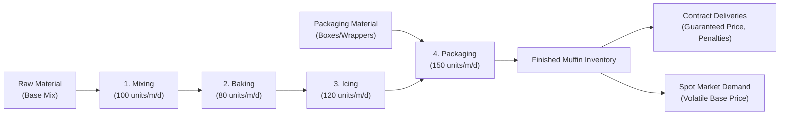

# 🧁 Project Overview — Muffin Factory Game

## 1. Executive Summary
**Muffin Factory Game** (also known as **Muffin Mega Factory**) is a web-based, multiplayer business and operations management simulation game designed for university students, MBA cohorts, and corporate executive education.

Players act as factory operators managing a bakery manufacturing enterprise across a simulated multi-day timeline (typically 30–60 days). Teams compete against each other in real-time or asynchronously within instructor-led cohorts.

The game teaches core concepts in operations management:
- **Theory of Constraints (Bottleneck Management):** Managing four distinct production stages (Mixing, Baking, Icing, Packaging).
- **Inventory Control & Order Point Policies:** Setting order quantities ($Q$) and reorder points ($ROP$) with stochastic lead times.
- **Capacity Planning & Capital Budgeting:** Purchasing machines with procurement lead times and balancing maintenance vs breakdown risks.
- **Supply Chain Contracts vs Spot Market Sales:** Allocating finished goods between guaranteed contracts with penalties and volatile spot market demand.
- **Financial Acumen:** Managing cash flow, holding costs, ordering fees, stockout penalties, and avoiding bankruptcy.
- **Multi-criteria Evaluation:** Comprehensive academic rubric weighting cash, fill rate, contracts, inventory efficiency, and capacity planning.

---

## 2. User Roles & System Boundaries

The platform supports three distinct user roles:

```mermaid
flowchart TD
    Admin["Super Admin<br>(Licenses, Cohort oversight)"] -->|Provisions| Instructor["Instructor<br>(Rooms, Scenarios, Events, Controls)"]
    Instructor -->|Facilitates| Operator["Student Operator / Teams<br>(Factory floor, Purchasing, Contracts)"]
    
    subgraph Client Application [Frontend SPA (React 18 + Vite)]
        Landing["Landing & Auth Page"]
        PlayerView["Player Factory Dashboard"]
        InstView["Instructor Control Room"]
        AdminView["Admin License & Cohort Portal"]
    end
    
    subgraph Server Application [Backend (Express + Socket.IO)]
        AuthService["Auth & JWT Services"]
        RoomManager["Room & Cohort Manager"]
        SimEngine["Deterministic Engine (engine.ts)"]
        SocketGateway["WebSocket Real-Time Gateway"]
    end
    
    Operator --> PlayerView
    Instructor --> InstView
    Admin --> AdminView
```

### 1. Student Operator (Player)
- Joins a game room using a 6-character room code and team credentials.
- Controls factory operations on a single interactive dashboard:
  - Raw material and packaging material order quantities and reorder points.
  - Machine purchases and activation states.
  - Contract review and acceptance (10-day advance notice window).
  - Production allocation strategies (Contracts First, Market First, Split).
  - Real-time analytics, financial audits, and downloadable PDF reports.

### 2. Instructor
- Creates and configures game rooms based on customizable or preset scenarios (Beginner, Intermediate, Advanced).
- Controls simulation pacing: Start, Pause, Resume, Tick Rate (seconds per day, e.g. 5s–30s).
- Injects dynamic operational events:
  - Demand surges / drops.
  - Raw material price shocks.
  - Supplier lead time delays.
  - Machine breakdown spikes.
- Live cohort leaderboard, team inspection, and post-game debrief analytics.

### 3. Super Admin
- Manages enterprise and university institution licenses (`LIC-XXXXXX`).
- Tracks seat allocations, active dates, and instructor accounts.

---

## 3. Production Workflow
The factory converts two raw materials into packaged muffins across four serial processing stations:



- **Material Requirements:** $1\text{ Muffin} = 1\text{ Unit Base Mix} + 1\text{ Unit Packaging Material}$.
- **Zero-Packaging Rule:** If either base mix or packaging material is zero, production is strictly zero (no phantom production or partial waste).
- **Serial Constraint:** Actual daily output is capped by $\min(\text{Raw Material Available}, \text{Bottleneck Machine Capacity})$.

---

## 4. Deployment & Infrastructure
- **Frontend Hosting:** Vercel ([https://muffin-factory-game.vercel.app](https://muffin-factory-game.vercel.app)). Continuous deployment linked to GitHub `main` branch.
- **Backend Server:** Render ([https://muffin-factory-game.onrender.com](https://muffin-factory-game.onrender.com)). Express HTTP + Socket.IO WebSockets.
- **Database:** PostgreSQL (with built-in in-memory fallback for local development or resilient operation if database connection drops).
